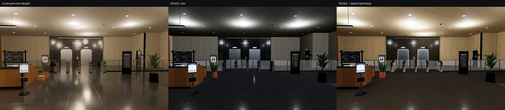
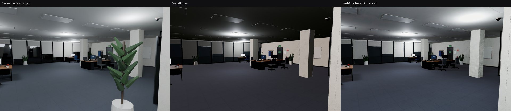
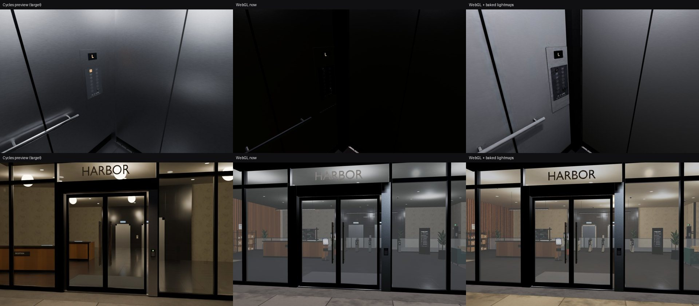

# Baked lighting (v3): make the WebGL lobby, floor 14, elevator cab and tower frontage look like the Cycles renders

The Cycles previews look warm and rich because Cycles computes bounce light, soft contact shadows and light pooling.
In WebGL the same models only get a handful of real-time lights, a hemisphere light and the env map, so they come
out flat and grey. These files **bake the Cycles night lighting into lightmaps** for the static environment. The game
keeps its own lights for the moving and interactive things (doors, flaps, LEDs, props, people, cars).





Each image: Cycles preview (the target) | the current WebGL look | WebGL with the baked files. The WebGL frames were
rendered headless with three.js r187 and the game's own settings (the same lights, `prepare()` overrides, env.hdr at
0.42, fog and ACES), so they show what you'll get in the game.

## Approach: A, lightmaps on a second UV set

Every baked mesh keeps its normal PBR material (the tiled base color, roughness and normal maps, at full detail) and
gets a second UV set (`TEXCOORD_1`, which three.js loads as `uv1`). Each area has one lightmap atlas holding only the
light (Cycles DIFFUSE bake, direct + indirect, no color). The shader then computes `albedo × baked light`.

Why A and not B (full lighting baked into the base color, unlit):
- **Detail.** Each area has 1,000–3,000 m² of surface. A 2K atlas holding the final colors would come out at about 2–3 cm
  per texel, so the granite, oak, carpet and brick textures would blur at first-person distance. A lightmap is
  low-frequency anyway, so 2–3 cm per texel is plenty for light. The texture detail stays sharp because it still comes
  from the tiled maps on UV0.
- **The game's look stays live.** Speculars from the game's lights, env reflections on the polished granite, fog and
  bloom all keep working. An unlit bake freezes one camera's highlights into the texture, and those highlights look
  wrong once the camera moves.
- **Small integration.** `tools/asset-build/bakedLighting.ts` is one 100-line helper. It reads everything from the
  node extras, so there are no tables to keep in sync.

The helper does one thing beyond setting `material.lightMap`. On baked materials it removes the *diffuse* part of the
real-time lighting: the point, spot and directional diffuse, the hemisphere and ambient light, and the IBL diffuse.
Those surfaces are therefore never lit twice. Specular from the real-time lights and env reflections stay on.

## Files

All of them live in `public/assets/models/`, with a mirror in `assets/models/`. Load each GLB at the origin. The cab is
the one exception: re-parent its baked shell, as described below.

| File | Size | Lightmap atlas | `lightmap_intensity` |
|---|---|---|---|
| `harbor_lobby_baked.glb` | 3.52 MB | `harbor_lobby_lm.jpg` 2048², 0.69 MB | 26.28536 |
| `harbor_frontage_baked.glb` | 3.13 MB | `harbor_frontage_lm.jpg` 2048², 0.52 MB | 3.67559 |
| `harbor_f14_baked.glb` | 4.33 MB | `harbor_f14_lm.jpg` 2048², 0.85 MB | 13.45492 |
| `harbor_cab_baked.glb` | 0.41 MB | `harbor_cab_lm.jpg` 1024², 0.10 MB | 20.06937 |
| `harbor_baked_lightmaps.json` | | manifest: replaces, nodes, intensity per file (informational: the GLB extras carry the same data) | |

Total: 13.6 MB.

Every baked node is named `<original>_Baked` and has these extras:
- `replaces`: the original node name.
- `lightmap`: the file name of the atlas, which sits next to the GLB.
- `lightmap_uv`: `1`.
- `lightmap_intensity`: the value for `material.lightMapIntensity`. It is already calibrated, because it equals π × the
  atlas encode scale × the area exposure.
- `baked: true`.
- The original `collider`, `role` and other extras are carried over unchanged.

### What each file replaces (hide these originals)

| Baked file | Hide these originals (the children go with them) | They live in |
|---|---|---|
| `harbor_lobby_baked.glb` | `Lobby_Interior_ShaftCut`, `SpeedGate_Bank`, `Lobby_Seating`, `Lobby_Plants`, `Lobby_Art`, `Mailroom_Shelf`, `Stair_Core` | `harbor_shaft_cut.glb` (Lobby_Interior_ShaftCut), `harbor_lobby_detail.glb` (the rest) |
| `harbor_frontage_baked.glb` | `Harbor_Tower_ShaftCut`, `Entrance_Canopy`, `Sidewalk`, `Curbs`, `Road` | `harbor_shaft_cut.glb` (Harbor_Tower_ShaftCut, which takes its child HARBOR_Sign_ShaftCut with it), `harbor_block.glb` (the rest) |
| `harbor_f14_baked.glb` | `Office_F14_Shell_ShaftCut`, `Desk_01`, `Desk_02`, `Desk_03`, `Desk_04`, `Desk_05`, `Desk_06`, `Desk_07`, `Desk_08`, `Break_Counter`, `ServerCloset_Walls`, `MeetingRoom_Furniture`, `PrintArea`, `Desk_Clutter`, `Coat_Hooks`, `F14_Plants`, `Window_Blinds`, `ServerRacks`, `Emergency_Exit_Frame` | `harbor_shaft_cut.glb` (Office_F14_Shell_ShaftCut + its Floor_Name/Floor_Number children), `harbor_office_f14.glb` (desks, break counter), `harbor_f14_detail.glb` (the rest) |
| `harbor_cab_baked.glb` | `Elevator_Cab_Shell` | `harbor_elevator_cab.glb` |

The frontage file also contains three **unbaked remainders**: `Sidewalk_Rest`, `Curbs_Rest` and `Road_Rest`, the parts
of the 200 m street outside x = ±27, and `Harbor_Tower_Upper`, the tower above the lobby roof. They use the original
materials and have no lightmap. Hide the originals and show these together with the baked pieces.

**Nothing interactive is replaced or renamed.** Every door, LED, flap, reader, button, indicator, lantern, screen
hook, CCTV dome, prop, car and character node stays in its original GLB, with its original name and extras.
`verify_baked.py` checks this:
- No baked node name collides with any node name in the original GLBs.
- Every `replaces` target exists in an original GLB.
- No `replaces` target is an interactive node.
- The original GLBs are not modified.

## Code changes Grok must make

### 1. Add the helper
Copy `tools/asset-build/bakedLighting.ts` to `src/game/baked.ts`. It needs no new dependencies (three r150+, tested
on r187).

### 2. Load the baked files (`scenery.tsx`)
```ts
import { applyBakedLighting, hideReplaced } from "@/game/baked";

const BAKED = ["harbor_lobby_baked.glb", "harbor_frontage_baked.glb", "harbor_f14_baked.glb", "harbor_cab_baked.glb"] as const;
for (const f of BAKED) useGLTF.preload(`${MODEL_BASE}${f}`);

// inside HarborWorld(), next to the other useGLTF calls
const lobbyBaked = useGLTF(`${MODEL_BASE}harbor_lobby_baked.glb`);
const frontBaked = useGLTF(`${MODEL_BASE}harbor_frontage_baked.glb`);
const f14Baked = useGLTF(`${MODEL_BASE}harbor_f14_baked.glb`);
const cabBaked = useGLTF(`${MODEL_BASE}harbor_cab_baked.glb`);
```

### 3. Swap them in (inside the existing `useMemo`, after the current `prepare()` / hide calls)
```ts
const baked = [lobbyBaked.scene, frontBaked.scene, f14Baked.scene, cabBaked.scene];
for (const s of baked) prepare(s);                      // same light/glass handling as everything else
const originals = [block.scene, office.scene, lobby.scene, floor.scene, cab.scene, shaft.scene];
for (const s of baked) hideReplaced(s, originals);      // hides every node named in the `replaces` extras

// the cab shell rides with the cab: re-parent the baked shell under the moving root (identity local transform)
const cabRoot = cab.scene.getObjectByName("Elevator_Cab");
const cabShell = cabBaked.scene.getObjectByName("Elevator_Cab_Shell_Baked");
if (cabRoot && cabShell) cabRoot.add(cabShell);

// attach the lightmaps (async: the materials swap as soon as the 4 JPGs are decoded, usually before the first frame)
for (const s of baked) void applyBakedLighting(s, MODEL_BASE);
```
`MODEL_BASE` is `/assets/models/`, the folder the JPGs are in. If you use `MODEL_FALLBACK`, pass that instead.

### 4. Render and collide
- Render `lobbyBaked.scene`, `frontBaked.scene` and `f14Baked.scene` with `<primitive object={...} />`. Don't render
  `cabBaked.scene` itself, because its shell now lives under the cab root.
- In the `useLayoutEffect`, run `collect()` on `lobbyBaked.scene`, `frontBaked.scene` and `f14Baked.scene`. The cab
  shell is picked up by the existing `collect(cab.scene)`, because it's now a child of the cab root. Run `collect()`
  **after** the hide step. The live `collect()` already skips invisible nodes, so the hidden originals drop out of the
  colliders.
- The baked nodes carry the same `collider` extras as the originals. The ground pieces keep
  `surface: concrete / asphalt_wet`, so they're skipped as before.

### 5. Two small `prepare()` additions for the cab (recommended)
The cab doors are interactive, so they aren't baked. In-game, the cab point light is scaled almost to zero, which
leaves the doors black next to the baked walls. Add these:
```ts
// in prepare(), in the light branch, after the GLTF_LIGHT_SCALE multiply and next to the Lobby_Light / F14_ overrides
if (light.name === "Elevator_Cab_Light") {
  light.color.set("#f1f4ff");
  light.intensity = 2.5;
  (light as THREE.PointLight).distance = 4;
}

// after loading the cab: brushed-steel doors read better with some diffuse (the baked shell does the same)
for (const name of ["Elevator_Cab_Door_L", "Elevator_Cab_Door_R"])
  cab.scene.getObjectByName(name)?.traverse((o) => {
    const m = o as THREE.Mesh;
    if (m.isMesh) { m.material = (m.material as THREE.MeshStandardMaterial).clone(); (m.material as THREE.MeshStandardMaterial).metalness = 0.5; }
  });
```
Baked meshes ignore real-time diffuse, so this brighter light only affects the doors, buttons and the player.

## Renderer settings

Keep what the game already uses:
- `gl.outputColorSpace = THREE.SRGBColorSpace`.
- Renderer `toneMapping = NoToneMapping`, plus the postprocessing `ToneMapping(ACES_FILMIC)` pass. If the composer is
  ever removed, use `renderer.toneMapping = THREE.ACESFilmicToneMapping`, `toneMappingExposure = 1`.
- `scene.environment = env.hdr` and `environmentIntensity = 0.42`. On baked meshes this now only gives reflections,
  so leave it.
- Hemisphere 0.15, the moon directional (0.32, shadowed) and the two fills. Leave them: they light the people, props
  and cars. Baked surfaces ignore their diffuse.
- Bloom (0.22, threshold 0.78). Leave it. The emissive downlights and panels still bloom.

One change is recommended: **fog indoors.** `fog(#121820, 16, 92)` starts at 16 m, which greys out the far half of the
lobby and the office (the lobby is 22 m deep). Use something like `scene.fog.near = indoors ? 45 : 16;
scene.fog.far = indoors ? 160 : 92;`, where `indoors` is `world.py > 40 || (|px| < 11 && pz < -0.8 && pz > -18)`.

Tuning knobs, all optional, passed as the third argument of `applyBakedLighting`:
- `exposure`: multiplies the baked light (1 = calibrated against the Cycles previews).
- `specular`: env-reflection strength on baked surfaces.
- `metalnessCap`: default 0.5. Lightmaps can't light pure metal, so baked metal is capped.
- `iblDiffuse` and `directDiffuse`: default 0. Raise them to 0.2–0.3 only if you want some real-time diffuse back on
  the baked surfaces.

## How it was made (rebuild)

`tools/asset-build/bake_lighting.py` (bpy 5.x) imports the shipped GLBs, so it uses the exact geometry and names. Then:
1. It builds each area with its night rig:
   - **Lobby:** the 6 `Lobby_Light` + 7 extra 260 W points, warm white `#ffe3bf` like the lobby previews.
   - **Frontage:** the 8 `Street_Sodium` spots `#ff9d45`, the canopy spots, light spill from the lobby, and a moon sun
     at 0.06 with a night world.
   - **Floor 14:** the 4 `F14_*` + 8 extra 180 W points, cool `#dfe9f5` like the floor-14 previews, plus the emissive
     ceiling panels.
   - **Cab:** its point light plus the emissive ceiling panel.
2. It welds coincident vertices, so coplanar faces share UV islands. It orients faces toward open space: the source
   meshes are double-sided and many faces pointed into their own solid. It also culls never-visible faces (under the
   street, above the lobby ceiling, outside the cab) from the UV space. None of this changes how the meshes render.
3. It adds the `Lightmap` UV (Smart UV Project, packed together per area with a 0.35 % margin) and bakes a
   Cycles DIFFUSE pass (direct + indirect) at 80 spp. Metals are baked as diffuse and normal maps are ignored
   during the bake. It then runs OIDN denoising, dilates the islands by 6 px and saves an sRGB JPEG.
4. It exports `*_baked.glb` with `TEXCOORD_0` (textures) + `TEXCOORD_1` (lightmap), with no lights.

```
python3 bake_lighting.py all --samples 80      # about 30–40 min on 2 CPU cores. Areas: cab | lobby | f14 | all
python3 verify_baked.py                        # names, replaces, UV1, no collisions
```
To change the lighting colors or intensities, edit the constants at the top of `bake_lighting.py`: `LOBBY_WHITE`
(set `#eef0f2` for a cool lobby), `OFFICE_WHITE`, `SODIUM`, `AREA_EXPOSURE` and the rig positions in each area
function.

## What stays real-time (not baked, untouched)
- **Lobby.** `Lobby_Door_L/R`, `BadgeReader` + LEDs, `Reception_Desk` + `Reception_Chair`, `Lobby_Glazing` (glass),
  every `Turnstile_*` flap / reader / status, `Gate_Balustrade_*` (glass), `Visitor_Kiosk`, `Visitor_Log_Clipboard`,
  `Security_Monitor_Bank`, `Directory_Sign`, `Sign_OneBadgeOnePerson_Lobby`, `Stair_Door` + reader / alarm / wedge,
  `Parcel_Unattended`, every `CCTV_*`, `Elevator_Lobby_*` doors / call button / lantern / indicator,
  `Elevator_Wall_Lettering`, the pendant fixtures, and `Street_Furniture` (lamps, bollards, hydrant).
- **Floor 14.** `Desk_Player`, `Chair_Player`, `Monitor_Player*`, `Keyboard_Player`, `DeskPhone` + ring light,
  `Laptop_Open`, `Envelope_Mail`, `USB_SalaryReview`, `Elevator_F14_A_*`, `MeetingRoom_Door`, `MeetingRoom_Glass_*`,
  `MeetingRoom_TV_Screen`, `MeetingRoom_Whiteboard`, `ServerCloset_Door` + reader, `ServerRack_LED*`, `Shred_Bin_Secure`,
  `Recycle_Bin_Paper`, `Trash_Bin`, `Printer_*`, `Sticky_Password_Desk07`, `Monitor_Desk07_Screen`, `Desk_Player_Mug`,
  `Emergency_Exit_Door`, `Fire_Extinguisher_*` and every `CCTV_*`.
- **Cab.** `Elevator_Cab` root, `Elevator_Cab_Door_L/R`, `Elevator_Cab_Button_*`, `Elevator_Cab_Indicator*`,
  `Elevator_Cab_Light`.
- **Everything else in the block:** the other buildings, the ship, the crane, containers, water, cars and people.

Those objects were present during the bake as occluders, in their default state (doors closed, flaps closed). That's
why the baked floor has their contact shadows.

## Known limits
- **Reflections.** Cycles' polished-granite floor reflects the bright lobby. WebGL reflects `env.hdr`, which is an
  outdoor sky, so the floors are less glossy than in the renders. A local reflection probe (a CubeCamera snapshot of
  the lobby used as `envMap` for the floor) would close most of that gap.
- **Interactive objects** (turnstile flaps, doors, desks you use, props) are still lit only in real time. They don't get
  baked contact shadows of their own, but they do receive the baked environment's light through the lights above.
- If a static object moves later (desks, plants), its baked shadow stays behind. Re-run the bake.
