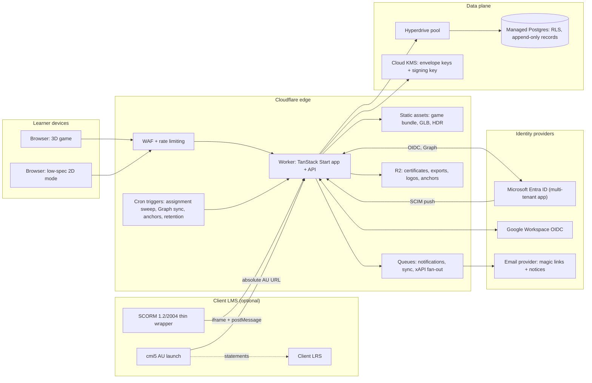
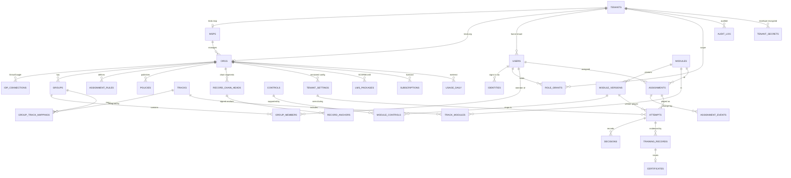
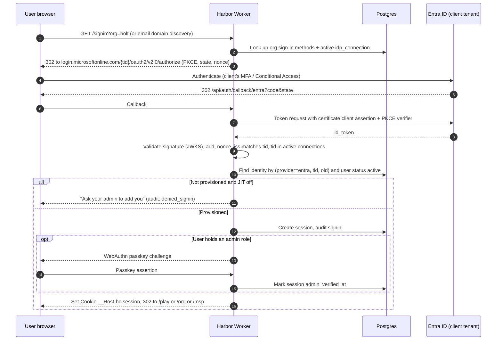
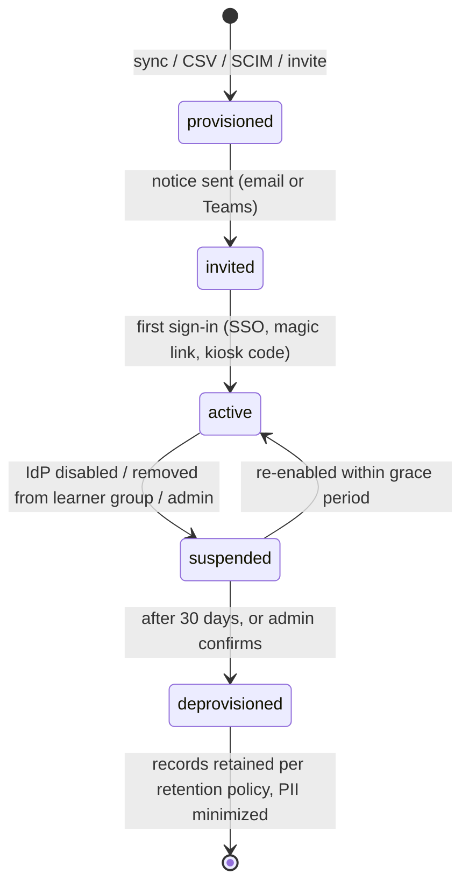
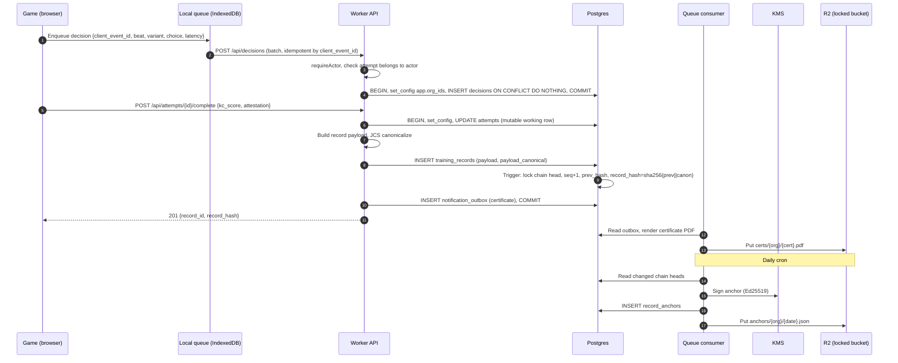
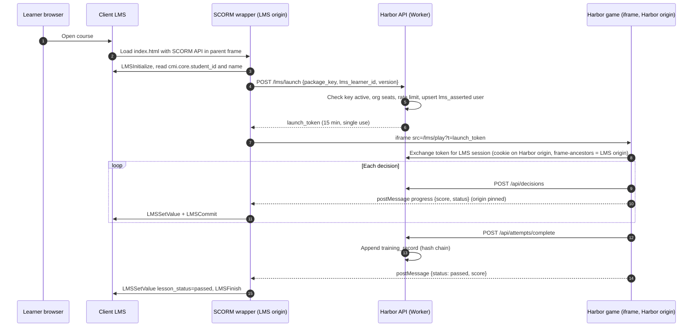

# Harbor & Co. — Platform Architecture (login, tenancy, evidence, delivery)

**Status:** Draft v0.1 for review, 2026-11-15. Written for Andrew (product owner) and for the coding agent that implements it.
**Companion files:** `docs/TRAINING_SPEC.md` (what the training must prove), `docs/schema/0001_platform.sql` (draft Postgres schema, not wired into `migrations/`).
**Scope:** how Harbor & Co. is sold through MSPs, how client employees sign in, how training records are kept so an auditor will accept them, and where it runs once it leaves Grok hosting.

> Same claim rule as TRAINING_SPEC §0: Harbor & Co. *supports* and *maps to* controls. Nothing in this document makes the platform or a client "compliant." The SOC 2 path in §9 is a plan, not a claim.

---

## Contents
1. What exists today (snapshot findings)
2. Architecture at a glance
3. Tenancy model
4. Identity and login
5. Security controls for a security product
6. Training records and evidence
7. Assignment engine
8. Tenant customization
9. Delivery: portal, LMS packages, low-spec mode, hosting
10. MSP commercial plumbing
11. Compliance of the platform itself
12. Threat model (STRIDE)
13. Phased build plan and tickets
14. Open questions for Andrew
15. Sources

---

## 1. What exists today (snapshot findings)

Read from the Grok snapshot (`/home/claude/grokzip`) and the live repo on Andrew's PC.

| Area | What's there | Survives leaving Grok? |
|---|---|---|
| Framework | TanStack Start + React 19 + react-three-fiber/three.js. Nitro server build. `vercel.json` plus `.vercel/output` (Nitro `vercel` preset, a single Node 22 function `__server.func` with every route rewritten to it). | **Yes.** It's a standard app. Nitro can target other presets (Cloudflare included), but that needs a spike (ticket P0-01). |
| Auth on/off | `.grok/app-env.json` has `VITE_AUTH_ENABLED: "false"` and `deploy.database: false`. **Auth and the database are both OFF.** There's no `src/routes/api/auth/$.ts`, no `login.tsx`, and only `migrations/auth/0001_auth.sql`, which is opt-in and never applied because `db.ts` doesn't glob subfolders. | n/a |
| Learner progress | `src/lib/progress.ts` is a zustand store persisted to **`localStorage`** under the key `meridian-field-v1`: XP, streak, lessons, drills, badges, shift best. **No server-side record of anything.** `/record` says so itself: "The working record stays in this browser." | Has to be replaced for evidence. Keep it as the offline cache and UI state. |
| Database | `src/lib/db.ts` uses Neon via `pg` when `DATABASE_URL` is set, otherwise **PGlite (Postgres compiled to WASM) in memory on the server**, not in the browser, and wiped on restart. Migrations are applied by `scripts/migrate.mjs` during `npm run build`. | `pg` + Postgres: yes. PGlite: fine for local dev and tests only. Applying migrations during the build is risky for production; move it to a separate release step. |
| Auth library | Better Auth `~1.6.30`, wired with `genericOAuth`, **federated to the Grok auth broker** (`GROK_AUTH_ISSUER`, `grok-google` / `grok-x` providers), plus `bearer()` for the preview iframe and `tanstackStartCookies()`. Email/password is off (`email-password.ts`). | Better Auth itself: **keep**. The broker config: **replace**. |
| Grok gate identity | `gate-identity.server.ts` and `gate-session.server.ts` turn a signed `x-grok-identity` header (EdDSA JWT from the Grok gate, JWKS at `/__gate/identity-key`) into a session with zero clicks. `popup.server.ts` and `preview.ts` hold a shared **preview client id/secret** and the `*.grok-sandbox.com` allowlist. | **No.** Entirely Grok-specific. Delete it from the production build. |
| Good security patterns | `isolation.server.ts` (Fetch-Metadata check that rejects scripted cross-site requests), `__Host-` cookie names, `trustedOrigins`, a single `authMiddleware` chokepoint that returns a verified `userId`, encrypted OAuth tokens at rest. | **Keep and extend.** These are the right instincts. |
| Platform chrome | `AGENTS.md` requires keeping `grokPwaPlugin()` / `server/middleware/grok-pwa.ts`, which inject `https://grok.com/grok-app-builder/extensions.js` (the "Created with Grok / Remix" pill), and forbids CSPs that block grok.com. | **Conflicts with the product.** A white-label security product can't ship a third-party script on every page, a "Remix" button, or a CSP with a grok.com hole. See §9.5 and Open Question 1. |
| Content/controls | `src/content/controls.ts` (live repo and snapshot match) has the `CONTROLS[]` catalog (CIS, NIST 800-53, 800-171, CMMC, HIPAA, CSF), `CONTENT_CONTROLS` (content id → control ids), `coverage()` and `gaps()`. | **Yes.** It's the seed for the `controls` and `module_controls` tables and the coverage report. |
| `src/game/records.ts` | **Doesn't exist** in the live repo yet (TRAINING_SPEC §6 step 3 isn't built). | The record shape in §6 of this doc becomes its contract. |

**Bottom line:** today the app is a single-player browser game whose progress lives in `localStorage`. Every part of the platform layer (tenants, login, records, reports) is new. The existing auth folder gives a good library choice and good cookie and CSRF hygiene, but its identity source (Grok's broker and gate) has to be replaced.

---

## 2. Architecture at a glance



**Recommended production stack:** Cloudflare Workers for the app and API, Workers Static Assets for the game bundle, **Hyperdrive in front of managed Postgres** (Neon Scale or an equivalent with a SOC 2 report), R2 for files, Queues and Cron for background work, and an external cloud KMS for keys. Reasoning and costs are in §9.4.

---

## 3. Tenancy model

### 3.1 Hierarchy

```
platform (Harbor & Co. staff)
 └── msp (partner, e.g. "Acme IT")             ← billing customer of Harbor
      └── org (client, e.g. "Bolt Machining")   ← the data owner; one HIPAA/CMMC scope
           ├── groups (synced from Entra/Google, or manual)
           ├── role tracks (finance, HR, IT, exec, shop floor/OT, CUI, clinical)
           └── learners (users)
```

- **tenants** is a single supertype table (`kind = platform | msp | org`, `parent_id`), with **msps** and **orgs** as 1:1 extension tables. One id space keeps foreign keys and RLS simple.
- **An org belongs to exactly one MSP at a time.** Moving an org between MSPs (a client changes providers) is an explicit, audited transfer that the client admin approves. Records stay with the org, not the MSP.
- **Direct customers** (no MSP) go under a house MSP owned by Harbor, so there's one code path.
- **A user row belongs to exactly one tenant.** MSP staff are users of the MSP tenant. Learners and client admins are users of the org tenant. If one human is both an MSP tech and a learner at their own MSP, they're two users. That's deliberate: it prevents an identity from accidentally spanning trust boundaries.

### 3.2 Roles (least privilege)

| Role | Scope | Can | Cannot |
|---|---|---|---|
| `platform_admin` | platform | Break-glass support, through a just-in-time grant with a reason, a 1-hour TTL and a second approver. Every action is audited and visible to the affected MSP. | Run day-to-day work through this role. |
| `msp_owner` | msp | Everything in the MSP; billing; manage MSP staff; white-label | Edit or delete training records (nobody can) |
| `msp_admin` | msp → all its orgs | Create orgs, connect IdPs, manage assignments, run reports | Billing, managing MSP owners |
| `msp_technician` | msp → **listed** orgs only | Assign, remind, view reports for the orgs they're granted | Change IdP connections, export full datasets |
| `msp_billing` | msp | Seat and usage reports, invoices | View any learner data |
| `org_admin` | org | Users, groups, settings, policy-change triggers, reports, exports | See other orgs; see MSP billing |
| `org_manager` | org → their groups | Reports for direct groups, reminders | Settings, exports of the whole org |
| `org_auditor` | org, **time-boxed** | Read-only reports, transcripts, evidence export, chain verification | Change anything. Expires automatically (default 30 days). Built for the client's assessor or C3PAO. |
| `learner` | self | Play assigned modules, see own transcript and certificates | Anything else |

Roles are rows in `role_grants (user_id, role, scope_tenant_id, expires_at)`, not columns on the user. Permissions are checked in code from a static role→permission map (`can(actor, 'records.export', orgId)`).

### 3.3 Isolation, in three layers

1. **Request context.** One middleware (the successor to `authMiddleware`) resolves the session to an `Actor { userId, homeTenantId, grants[], allowedOrgIds[] }`. Server functions never take a tenant id from the client without checking it against `allowedOrgIds`.
2. **Postgres Row-Level Security.** Every tenant-scoped table carries `org_id` (and a denormalized `msp_id` where MSP-wide queries are common). Each request runs in a transaction that starts with `select set_config('app.actor_id', $1, true), set_config('app.org_ids', $2, true)`, which is transaction-local and therefore safe with Hyperdrive's pooling. Policies compare `org_id = any(current_setting('app.org_ids')::uuid[])`. The application DB role is **not** the table owner and has no `BYPASSRLS`. A forgotten `where org_id = …` returns nothing instead of leaking.
3. **Tests.** A cross-tenant test suite seeds two MSPs × two orgs and asserts that every server function returns 403 or empty results across boundaries. It runs in CI on every change (ticket P0-05).

MSP → client access is visible to the client: every MSP read or write in an org is written to that org's `audit_log` with `actor_tenant_id = msp`, and the client admin's portal shows "MSP access history." A client can also set `msp_access = 'reports_only'` to block MSP edits.

### 3.4 Data model (ERD)

Full column-level detail is in `docs/schema/0001_platform.sql`. The draft was applied to a scratch PostgreSQL 16 and smoke-tested on 2026-11-15:
- the hash chain links correctly and verifies independently;
- `UPDATE` on `training_records` fails both for the app role (no grant) and for the superuser (trigger);
- with the app role, RLS returns 0 rows across tenants and rejects cross-tenant inserts;
- an unset scope sees nothing;
- the purge guard refuses unexpired segments.

Core relationships:




---

## 4. Identity and login

### 4.1 Learner sign-in options, ranked for SMB reality

| Rank | Method | Who it fits | Notes |
|---|---|---|---|
| 1 | **Microsoft Entra ID SSO (OIDC)** + directory sync | Most MSP-managed SMBs run Microsoft 365, so this is the default path. | One multi-tenant app registration owned by Harbor; per-client admin consent (§4.3). Sync via Graph (MVP) or SCIM (v1). |
| 2 | **Google Workspace OIDC** | Google shops | Check the `hd` claim against the org's verified domains. Directory sync (Admin SDK + domain-wide delegation) is v2 because it's heavier. |
| 3 | **Email magic link** (passwordless) | Orgs without an IdP, contractors, seasonal staff | Single-use, 15-minute token, stored hashed. Rate-limited per email and IP. Only for emails pre-provisioned in the org (no self-signup into an org). |
| 4 | **Kiosk / badge code** | Shop-floor and OT workers **with no company email** (common in manufacturing) | The org admin prints one-time 8-character codes or QR codes per learner. A code gives a learner-only session on a shared kiosk, with no admin capability. Sessions end at 2 hours or when the module completes. *This is a real gap in competitors; confirm demand with the launch MSPs.* |
| 5 | **Launch from LMS** (SCORM/cmi5) | Clients that already run an LMS | No Harbor account. The identity is the LMS learner id, which the LMS asserts. See §9.2. |

There are **no passwords** for learners. Passwords add breach liability, resets and support calls, and a security-training vendor storing passwords invites the wrong kind of audit question. Better Auth's email/password mode stays off.

### 4.2 Admin authentication (MSP and client admins)

- **A passkey (WebAuthn) is required** for every role above `learner`. Enrollment happens at the first admin sign-in, and an admin can't skip it. TOTP is allowed only as a second factor for users whose devices can't do passkeys, and it's flagged in the admin list.
- An admin may *sign in* with Entra SSO, but we **also require the Harbor passkey** for admin sessions. That's because we can't reliably verify that the client's Conditional Access actually enforced MFA: Entra ID tokens don't consistently carry `amr` claims for this. The cost is one extra tap, and in exchange MFA doesn't depend on someone else's configuration.
- **Step-up:** exports, IdP connection changes, retention changes, role grants and org deletion require a passkey assertion made within the last 5 minutes.
- **Recovery:** an MSP owner can reset a client admin's passkey, and Harbor support can reset an MSP owner's only with identity verification and a 24-hour delay. Both are audited and notified to every other admin in the tenant.

### 4.3 Connecting a client's Entra tenant (the MSP flow)

1. Harbor owns **one multi-tenant app registration** (`signInAudience = AzureADMultipleOrgs`) whose credential is a **certificate**, not a client secret. The private key lives in KMS or HSM-backed storage and is used to sign client assertions. [Microsoft: convert an app to multi-tenant](https://learn.microsoft.com/en-us/entra/identity-platform/howto-convert-app-to-be-multi-tenant)
2. Permissions requested, kept to the minimum:
   - Delegated: `openid`, `profile`, `email` (sign-in only).
   - Application, for sync only, and only if the org turns on Graph sync: `User.Read.All` and `GroupMember.Read.All`. **Not** `Directory.Read.All`, and nothing that writes.
3. In the MSP portal: **Org → Identity → "Connect Microsoft 365."** We create an `idp_connections` row (`status = pending`, random `state` nonce bound to the org and the requesting admin) and redirect to
   `https://login.microsoftonline.com/{client-tenant-id or organizations}/v2.0/adminconsent?client_id=…&scope=https://graph.microsoft.com/.default&redirect_uri=…&state=…`.
   The person approving has to be an admin in the client tenant who's allowed to grant tenant-wide consent. Often that's the MSP tech acting through GDAP, but confirm the roles with your MSPs. Granting Graph application permissions typically needs a Global Administrator or Privileged Role Administrator. *Verify against current Microsoft docs before writing onboarding guides.*
4. On the callback, check `state`, then **don't trust the returned `tenant` parameter**. Microsoft warns that it can be forged. [Admin consent docs](https://learn.microsoft.com/entra/identity-platform/v2-admin-consent) Instead, request a client-credentials token *for that tenant* and call `GET /organization` to confirm the tenant id and verified domains, then mark the connection `active` and store `entra_tenant_id` (unique across the platform, so one Entra tenant can't be claimed by two orgs).
5. Admins choose **which security group(s) are learners**. Sync never pulls the whole directory unless they say so explicitly.

**ID token validation for multi-tenant sign-in:** accept tokens whose `iss` is `https://login.microsoftonline.com/{tid}/v2.0`, where `tid` matches an **active** `idp_connections` row. Key the identity on **`(tid, oid)`**, never on email, since emails and UPNs change and get reused. If the user isn't already provisioned in that org (by sync or invite), deny sign-in, unless the org has turned on JIT provisioning for members of its learner group.

**SSO login sequence (Entra, learner or admin)**



### 4.4 Directory sync: Graph pull (MVP), SCIM push (v1)

| | Graph delta pull | SCIM 2.0 push |
|---|---|---|
| Setup for the MSP | Nothing beyond the consent click | Configure provisioning on the Enterprise App: tenant URL plus a secret token we issue |
| Freshness | Our cron (e.g. every 4 hours, plus "sync now") | Entra's cycle, roughly every 20–40 minutes, varies by app ([summary](https://ssojet.com/blog/entra-id-scim-requests-what-entra-sends)) |
| Offboarding | We see `accountEnabled=false` or removal from the group in the delta | Entra sends `PATCH active=false`. `DELETE` only comes after hard delete (by default 30 days later) and may never arrive, so **act on `active=false`**. |
| Gotchas | Throttling; delta tokens expire | PATCH quirks: without the `aadOptscim062020` flag Entra may send `"False"` as a string with capitalized ops, so accept both ([Microsoft SCIM compatibility](https://learn.microsoft.com/nb-no/entra/identity/app-provisioning/application-provisioning-config-problem-scim-compatibility)). Test Connection filters on a random `userName` and expects an empty `ListResponse`. Only direct group members are provisioned. |
| Recommendation | **MVP**: one consent covers SSO and sync | **v1**: offer it for clients whose MSP prefers the standard. Gallery listing later. |

SCIM bearer tokens are generated by us, shown once, and **stored only as SHA-256 hashes** with a prefix for lookup. That way there's no reversible secret to protect.

Both paths write to the same `directory_events` stream (`user_created`, `user_updated`, `user_disabled`, `group_membership_changed`), and that stream drives the assignment engine (§7).

### 4.5 Sessions

- Sessions are server-side and revocable, managed by Better Auth. The cookie is `__Host-hc.session` with `HttpOnly; Secure; SameSite=Lax; Path=/`. The `__Host-` prefix carries over from today's code.
- Lifetimes: **learner** 8 hours absolute and 2 hours idle; **kiosk** 2 hours, ending on module completion; **admin** 8 hours absolute, 30 minutes idle, with step-up as in §4.2.
- The session id is rotated at sign-in and whenever privileges change. Logout and deprovisioning delete every session for the user.
- Better Auth's `session_data` cookie cache stays **off for admin sessions**, so a revoked admin is locked out at the next request rather than up to 5 minutes later. It can stay on (60 seconds) for learners.
- `bearer()` (needed only for Grok's partitioned preview iframe) is removed from production. The LMS iframe path uses its own short-lived launch token (§9.2).

### 4.6 Invitation, onboarding, offboarding, account linking



- **Onboarding:** a user reaches `provisioned` from sync, CSV upload, SCIM or a manual invite. Hire-based assignment (§7) runs at this point. The invite email or Teams message deep-links to the org's sign-in page, which offers only the methods that org has enabled.
- **Offboarding:** on `suspended`, sessions are revoked and assignments paused (no overdue noise for people who've left). **Training records are never deleted when someone is offboarded**, because the auditor still needs proof that the person was trained while employed. At `deprovisioned` the user row is minimized: name and email are kept for transcripts, everything else is dropped.
- **Account linking:** the same person may arrive by more than one method (an invite via magic link, then Entra SSO later). Link **only** when the new identity's verified email exactly matches the provisioned user **in the same org** and the org trusts that provider. Never link across orgs, never link an unverified email, and record each link in `audit_log`. This is stricter than today's `trustedProviders` setting, which links without requiring a verified email (needed for Grok's synthetic X emails, but wrong for us).

### 4.7 Credentials and secrets storage

- **Avoid having per-tenant secrets at all where possible.** The Entra design above needs **no per-client secret**: one platform certificate, consent per tenant. SCIM tokens and kiosk codes are stored as hashes. Magic-link tokens are hashed.
- When a per-tenant secret really can't be avoided (a Google service-account key in v2, an MSP's PSA API key, a customer LRS credential), use **envelope encryption**: a data key per tenant, wrapped by a KMS key (AWS KMS or GCP KMS, called from the Worker over HTTPS with a narrowly scoped IAM identity). The `tenant_secrets` table stores only `ciphertext`, `wrapped_dek`, `kms_key_id` and `key_version`. Plaintext exists only in Worker memory for the duration of the call.
- Platform secrets (KMS credentials, the email API key, the Better Auth secret) live in **Workers Secrets**, never in the repo, never in `.grok/`, and never in `VITE_` variables.
- Rotation: the KMS key rotates yearly. The Entra certificate rotates yearly with overlap (two certificates registered during rollover).

---

## 5. Security controls for a security product

Buyers will ask. Here is each control and why it's there.

| Control | Implementation | Why |
|---|---|---|
| **Least privilege** | Role map in §3.2; MSP technicians limited to listed orgs; Graph permissions read-only and group-scoped; a separate DB role for the retention job (the only role allowed to `DELETE`, and only through a security-definer function) | Limits blast radius when an MSP account is phished, which is the realistic attack. |
| **Audit log of admin actions** | `audit_log` is append-only and hash-chained per tenant, like the records. It captures actor, actor tenant, impersonation or "acting as," action, target, before/after diff (PII-redacted), IP, user agent and request id. Viewable by org admins for their org and by MSP owners for the MSP. Exportable. | Auditors want proof that records and settings weren't quietly changed. Clients want to see what their MSP did. |
| **CSRF** | `SameSite=Lax` cookies, the **Fetch-Metadata check from `isolation.server.ts`** (keep it), an exact-match `Origin` check on every non-GET request, and Better Auth `trustedOrigins` limited to production origins | Defense in depth. Fetch-Metadata blocks scripted cross-site requests even from same-site siblings. |
| **XSS** | A strict nonce-based CSP: `script-src 'self' 'nonce-…'`, `object-src 'none'`, `base-uri 'none'`, `frame-ancestors` limited to the LMS origins registered for that package (otherwise `'none'`). Tenant strings (company name, policy names, help-desk number) are **always rendered as text**, never through `dangerouslySetInnerHTML`, and validated on input (length, character set, E.164 for phone numbers, `https:`/`mailto:` only for links). Logo uploads accept PNG/JPEG/WebP only, are re-encoded server-side, have SVG rejected, and are served from a separate cookieless asset hostname. | Tenant-controlled text shows up in every learner's game. One stored-XSS bug would let an attacker phish a whole client through *our* product. |
| **Rate limits** | Cloudflare WAF rate rules at the edge, plus the Workers rate-limiting binding in code: magic link at 3 per email per 15 minutes and 20 per IP per hour; kiosk code attempts at 10 per IP per 10 minutes, after which the code locks; SCIM at 50 requests/second per token; the LMS launch endpoint per package key | Stops enumeration, email bombing and brute-forcing kiosk codes. |
| **Clickjacking** | `frame-ancestors 'none'` everywhere except `/lms/*` launch routes, which allow only the registered LMS origins | The LMS wrapper is the only legitimate framing case. |
| **Transport** | HSTS (preload once the domain is stable), TLS 1.2+ at Cloudflare, TLS required from Hyperdrive to Postgres | Baseline. |
| **Dependency and supply chain** | Lockfile committed, `npm audit` / OSV scan in CI, Renovate, and **no third-party runtime scripts** (which rules out the Grok extensions script) | Every third-party script is a full compromise path into every tenant. |
| **Secrets** | §4.7 | |
| **Security headers** | `X-Content-Type-Options: nosniff`, `Referrer-Policy: strict-origin-when-cross-origin`, `Permissions-Policy` disabling camera, mic and geolocation | Baseline. |
| **Logging hygiene** | No tokens, codes or full emails in application logs; request ids correlate with `audit_log` | Logs often get exported to third parties. |

---

## 6. Training records and evidence

### 6.1 What's stored (TRAINING_SPEC §4 fields)

Three layers, from fine-grained to what an auditor samples:

1. **`decisions`**: one row per in-game choice (beat id, variant id, choice id, outcome, score, latency in ms, reported yes/no, control ids). This feeds behavior metrics (reporting rate, time-to-report, repeat errors) and maps 1:1 to the xAPI statements in TRAINING_SPEC §4.
2. **`attempts`**: one row per play of a module version (started, completed, score, passed, attempt number, delivery channel `portal | scorm12 | scorm2004 | cmi5 | kiosk`, render mode `3d | 2d`).
3. **`training_records`**: the **append-only evidence record**, one per outcome event: `assigned`, `completed`, `passed`, `failed`, `attested`, `certificate_issued`, `waived`, `correction`. Each record carries a frozen snapshot of the TRAINING_SPEC §4 fields:

`tenant/org_id, user_id, email (snapshot), roles (snapshot), module_id, module_version, content_hash, assigned_at, reason (hire | annual | policy_change | remediation | manual), started_at, completed_at, decisions_digest (hash plus count of the decision rows), score, passed, attempts, attestation_accepted_at, certificate_id, settings_version (the tenant config the learner saw), identity_source (sso | magic_link | kiosk | lms_asserted)`.

Snapshots matter: if the learner's email or role changes later, the record still shows what was true at the time.

### 6.2 Append-only and tamper evidence

- **The database enforces append-only:** the app role has `INSERT, SELECT` only, never `UPDATE` or `DELETE`, and a `BEFORE UPDATE OR DELETE` trigger raises an error even for the owner unless a narrowly scoped retention function sets a session flag. A mistake gets fixed by inserting a `correction` record that points at it with `supersedes_id`, plus a reason and the actor.
- **A hash chain per org per year (a "segment"):** a `BEFORE INSERT` trigger locks the segment's `record_chain_heads` row (`SELECT … FOR UPDATE`), assigns `seq = head.seq + 1`, sets `prev_hash = head.last_hash`, and computes
  `record_hash = sha256(prev_hash || payload_canonical)`,
  where `payload_canonical` is the record's JSON canonicalized by the app using **RFC 8785 (JCS)**. The trigger also checks `payload_canonical::jsonb = payload`. Chains are per org, so one org's write volume never blocks another's.
- **Signed anchors:** a daily cron computes, for each segment that changed, `anchor = { org_id, segment, seq, last_hash, at }`, **signs it with an Ed25519 key held in KMS**, and writes it to `record_anchors` and to an R2 bucket under a retention lock. *R2 bucket locks: verify the current feature set and that they're immutable enough for this use.* Anyone who rewrites history inside the database would also need the KMS signing key, and would have to rewrite the R2 copies.
- **Verification:** the evidence export (§6.6) contains the records, the chain and the signed anchors, plus a small open-source `verify-harbor-chain` script (Node and Python) that an assessor can run offline. The portal also offers a "Verify integrity" button that shows the result.
**Record write sequence**



- **Be honest about what this proves:** the chain shows records weren't *changed or removed after the fact* without detection. It doesn't prove the learner was the person sitting at the keyboard. That's what SSO, passkeys and identity source are for, and LMS-asserted identities are labeled as such.

### 6.3 Retention

- The default is **6 years** after the record date (the HIPAA documentation rule). It's configurable per org from 3 to 10 years, and lowering it requires step-up auth plus an org_admin confirmation, and is audited.
- Purges run **by whole segment** (an org-year), so the chain stays verifiable: a retention job deletes an expired segment's records and decisions, keeps its final anchor, and writes a `retention_purges` row (a tombstone listing segment, count, last hash and who approved it). Auditors see that a purge happened and when.
- Legal hold: `orgs.legal_hold = true` stops all purges.

### 6.4 xAPI: build or use an LRS?

**Recommendation: don't run a conformant LRS in the MVP.** Store decisions and attempts in our own Postgres tables (they're already xAPI-shaped) and *generate* xAPI statements from them on demand.

- **cmi5 launches** already come with an LRS: the client's LMS provides the endpoint and the auth token, and the AU (our game) sends statements **to the LMS's LRS** ([cmi5 AU flow](https://aicc.github.io/CMI-5_Spec_Current/flows/au-flow.html)). We mirror the same events into our own tables.
- **Customers who want our data in their LRS** (v2): an outbound forwarder on a Queue posts statements to a customer-configured LRS endpoint, with credentials encrypted per §4.7.
- **If we ever need an inbound conformant LRS endpoint**, the candidate is Yet Analytics **SQL LRS** (Apache-2.0, Postgres backend) ([project](https://awesome.ecosyste.ms/projects/github.com%2Fyetanalytics%2Flrsql)). It runs on the JVM, though, so not on Workers; it would need a small container host. Commercial options (Veracity, Rustici's hosted LRS in SCORM Cloud) avoid running it ourselves. ADL's [Choosing an LRS](https://www.adlnet.gov/assets/uploads/ChoosingAnLRS.pdf) is a useful checklist. *Its last public push was in Oct 2024, so check whether it's maintained before relying on it.*

The statement shape follows TRAINING_SPEC §4: actor = an `account` object (homePage = the org's portal URL, name = the learner's user id), **not** the email, to minimize PII in LMS exports unless the LMS supplies its own actor. Verbs are `decided` / `reported` / `passed`, object = the beat id IRI, and `context.extensions` carries control ids, variant id and module version.

### 6.5 Certificates

- Issued on `passed` (knowledge check ≥ 80%) together with an attestation ("I've read and will follow the {{POLICY_NAME}}").
- Generated as a PDF by a Queue consumer, stored in R2 at `certs/{org_id}/{certificate_id}.pdf`, and linked from a `certificates` row that carries `record_hash`.
- Each certificate shows a **verification URL and QR code** (`/verify/{certificate_id}`) that returns *only* valid/invalid, org name, module, version, date and a masked name. No email, no other records.
- Certificates can be revoked (if issued in error) with a `correction` record. The verify page then shows "revoked."

### 6.6 Auditor reports

Every report is available as **PDF and CSV**, one click, filterable by date range and group:

1. **Framework coverage matrix** built from `controls.ts` → `controls` / `module_controls`: control → supporting modules → % of in-scope learners who passed during the period → date range → gaps (reusing `coverage()` / `gaps()`; program-level controls are marked "met by program operation").
2. **Learner transcript**: one person's dated records and certificates (what an assessor samples).
3. **Overdue list**: new hires past their window, annual renewals due or late, remediation outstanding.
4. **Behavior trend** (v1): reporting rate, time-to-report, repeat-error rate by skill (the impact focus in NIST 800-50 r1).
5. **Assignment change log**: who assigned, waived or extended what, and why (from `assignment_events`).
6. **Evidence package** (zip): every report above, plus records JSON, chain, anchors, the verifier script and a README explaining what each file proves.

### 6.7 Data export when a contract ends

- An org admin or MSP owner can request a **full export** at any time: the evidence package plus users, groups, assignments, attempts, decisions and audit log, in JSON Lines and CSV, with a manifest of hashes.
- When a contract ends, the org goes to `read_only` for **90 days**, then `archived`. Records are kept for the retention period by default, because the client may still need them for an audit years later. A paid "records vault" tier (low cost, read-only) covers that. A client that asks for deletion gets a deletion certificate, **after** confirming in writing that they've exported the records they need. *Contract language decides this; see Open Questions.*

---

## 7. Assignment engine

### 7.1 Model

- **`assignment_rules`** (per org): trigger + target + modules + due window.
  - `on_hire`: when a user is provisioned, or their `employeeHireDate` is in the future or recent, assign the Core Shift plus any role tracks for their groups, due within N days (default 30).
  - `annual`: re-assign on the anniversary of last completion, or on a fixed calendar date the org chooses, due within N days.
  - `policy_change`: an org admin clicks **"Policy changed"** on a `policies` row, choosing which modules are affected (pre-filled from module tags). Everyone in scope is re-assigned with reason `policy_change` and a link to that policy version.
  - `remediation`: when a learner fails the same skill on M of their last N decisions (defaults: 2 of 3), assign the short remediation episode for that skill, due in 14 days. Capped at one remediation per skill per 30 days, so nobody is stuck in a punishment loop.
  - `manual`: an admin assigns modules to a user or group.
- **Role tracks:** `tracks` (finance, HR, IT, executive, shop_floor_ot, cui_handler, clinical) are sets of modules. `group_track_mappings` connect an Entra or Google group (or a manual group) to a track. Group membership changes from sync re-evaluate tracks. **This is the evidence for role-differentiated assignment** that CMMC AT.L2-3.2.2 and CIS 14.9 assessors look for.
- **`assignments`** is the current state (one row per user × module × cycle). **Every change** (create, extend due date, waive, cancel, complete) appends an `assignment_events` row with actor and reason. TRAINING_SPEC requires that every edit to an assignment is logged.

### 7.2 Execution

- A **cron sweep** every hour per region: it evaluates time-based rules (annual, overdue flips, reminder schedule) in batches per org, using `FOR UPDATE SKIP LOCKED` so it can run concurrently.
- **Event-driven:** directory events and decision writes go on a Queue, and the consumer applies `on_hire`, track and remediation rules. It's idempotent: the unique key `(org_id, user_id, module_id, cycle_key)` prevents duplicate assignments.
- **Dry run:** before an org admin saves a rule or presses "policy changed," the UI shows "this will assign X modules to Y people."

### 7.3 Notifications

| Channel | MVP | Later |
|---|---|---|
| Email (learner invite, due soon, overdue, certificate) | Yes, through a transactional provider (Postmark, SES or Resend). The sender comes from the Harbor domain at first and from the MSP's domain (white-label, DKIM) in v1. | Localized EN/ES |
| Admin digest (weekly overdue summary) | Email | Teams channel |
| Microsoft Teams | — | v1: post the admin digest to a channel through a **Workflows (Power Automate) webhook URL** the org pastes in (Microsoft has been retiring classic Office 365 connectors; *verify current status*). v2: a Teams app/bot for learner DMs, which needs a Teams app manifest and additional consent. |

All notifications go through `notification_outbox` (transactional outbox → Queue). Cadence defaults: on assignment, 7 days before due, on due date, then weekly for 3 weeks, then only in the manager digest. Every send is logged, which makes up the "security reminders" evidence trail for HIPAA (A).

---

## 8. Tenant customization

| Setting | Token | Validation | Where it shows |
|---|---|---|---|
| Company display name | `{{COMPANY}}` | 1–60 characters, letters/digits/space/`&.,'-` | In-game signage, emails, certificates |
| Help-desk number | `{{HELPDESK_PHONE}}` | E.164, shown formatted | **The in-game badge** (the vishing callback beat) |
| Reporting channel | `{{REPORT_CHANNEL}}` | Enum + value: `report_button` (e.g. "Report Message in Outlook"), `email` (validated address), `phone`, `portal_url` (https only) | Debriefs, "Report phishing" beat |
| Policy names | `{{POLICY_AUP}}`, `{{POLICY_IR}}`, … | 1–80 characters, text only | Debriefs, attestation text |
| IR contacts (Friday team mode) | `{{IR_CONTACT_n}}` | Role + phone/email | Incident Night |
| Logo | — | PNG/JPEG/WebP ≤ 512 KB, re-encoded, max 1024 px; served from the asset domain | Portal header, certificates, in-game lobby screen |
| Language | — | `en` / `es` (org default; learner can override) | All UI and content |
| Brand colors (white-label, MSP level) | — | Hex, contrast-checked against WCAG AA | Portal only (the game keeps its art direction) |

Settings are **versioned** (`tenant_settings` row per version). Each attempt records the `settings_version` it ran with, so an auditor can see the exact help-desk number and reporting channel a learner was taught. The game reads settings from one server endpoint, `/api/org/settings/current`, which returns text only, and the scenario engine substitutes tokens client-side **as text nodes**.

Hierarchy: platform defaults → MSP defaults (e.g. the MSP's own help-desk number for all clients) → org overrides.

---

## 9. Delivery: portal, LMS packages, low-spec mode, hosting

### 9.1 Hosted portal

One app, three surfaces, with route groups that have their own guards:
- `/play/*`: learner game (3D or 2D), transcript, certificates.
- `/org/*`: client admin (users, groups, assignments, settings, reports).
- `/msp/*`: MSP console (all clients, roll-up overdue dashboard, onboarding wizard, billing).
- Plus `/lms/*` (launch endpoints), `/scim/v2/*`, `/verify/*`, `/api/*`.

Hostnames: `app.<brand>` for the portal, `assets.<brand-assets>` (a separate registrable domain, cookieless) for logos and certificates, and in v1, MSP vanity hostnames (`training.acmeit.com`) through Cloudflare for SaaS custom hostnames.

### 9.2 SCORM and cmi5 packages: the thin-wrapper approach

We **never ship the game inside the LMS zip**. The package is a small launcher that loads the hosted game, so content updates, tenant tokens and records all stay central. This is the same idea as Rustici's commercial "Dispatch" ([Rustici](https://rusticisoftware.com/resources/play-xapi-content-scorm-lms/)), built in-house for one product.

**SCORM 1.2 / 2004 wrapper** (`harbor-<org>-<module>-scorm12.zip`):
- Contents: `imsmanifest.xml`, `index.html` and `wrapper.js` (a small SCORM API finder or an MIT library such as scorm-again; *check its license*), plus `config.json` holding `package_key` (public id), `api_origin` and `module_id`.
- Flow: the wrapper finds the LMS API (`API` for 1.2, `API_1484_11` for 2004), reads the learner id and name, then calls `POST {api_origin}/lms/launch` with `{package_key, lms_learner_id, lms_learner_name, scorm_version}`. It receives a **short-lived launch token** (15 minutes, single-use, bound to package and learner) and opens the hosted game in an **iframe** with that token.
- The game reports progress to the wrapper over **`postMessage`, with the origin pinned on both sides**. The wrapper calls `LMSSetValue` / `SetValue` (`cmi.core.lesson_status` / `cmi.completion_status` + `cmi.success_status`, score) and commits at checkpoints and on unload. The game also writes to our API directly, so our record exists even if the LMS loses its data.
- **Security caveat:** a SCORM zip can't hold a secret, because anyone with the zip can read `package_key`. So package keys are **scoped to one org**, revocable, rate-limited and **seat-counted**. Unknown learner ids create `identity_source = 'lms_asserted'` users in that org (or are rejected if the org has turned off auto-create). The system of record for "who completed" on this path is the client's LMS, and our reports say so.

**cmi5** (`cmi5.xml` in a zip):
- The AU `url` is our **fully qualified** launch URL (`https://app.<brand>/lms/cmi5?module=…`). The LMS appends `endpoint`, `fetch`, `actor`, `registration` and `activityId`. *Confirm the exact parameter rules and absolute-URL allowance in spec §8.1 / §13 ([cmi5 spec](https://github.com/AICC/CMI-5_Spec_Current/blob/818b03a4bf3d217df168796d35f06c2ba83b1b10/cmi5_spec.md)).*
- The game POSTs to `fetch` **once** to get the LRS auth token (the fetch URL is single-use), sends `initialized`, then `completed` / `passed` / `failed` (each only once per registration), plus our `decided` statements with the cmi5 context template, then `terminated` ([AU flow](https://aicc.github.io/CMI-5_Spec_Current/flows/au-flow.html)). The LMS's LRS has to allow CORS from our origin. Most do, but test each launch customer's LMS.
- Conformance: test with ADL's **CATAPULT** cmi5 test suite before claiming cmi5 support.



*Third-party cookie caveat:* a cookie set inside a cross-site iframe is partitioned or blocked by modern browsers. The LMS session therefore uses the launch token exchanged for an **in-memory bearer token held by the game**, not a cookie. This is the same problem today's `bearer()` plugin solves for Grok's preview iframe, so the pattern carries over, scoped to `/lms/*` and limited to learner-only permissions.

### 9.3 Low-spec 2D mode

- **Same scenario JSON, different renderer** (TRAINING_SPEC §5). A storyboard view: an illustrated still per beat, the choice buttons, the consequence card, the debrief. No WebGL.
- Selected automatically when WebGL2 is missing, `navigator.hardwareConcurrency ≤ 2`, `deviceMemory ≤ 4`, a low frame rate is detected in the first 5 seconds, or `prefers-reduced-motion` is set. Learners can switch either way, and the org can force 2D.
- **This is the WCAG 2.1 AA path:** keyboard-only play, visible focus, captions or transcripts for all audio, 4.5:1 contrast, no timing-only challenges (or adjustable time), screen-reader labels. The 3D mode is offered *alongside* it as an enhanced experience. Treat the 2D mode as the conforming alternate version, and get an accessibility audit before claiming AA.
- The record stores `render_mode`, and both modes produce the same records and certificates.

### 9.4 Hosting: escaping Grok, and Cloudflare vs Vercel

**Grok-specific pieces that have to go** before production: the gate identity and session plugins, the preview client secret and `*.grok-sandbox.com` allowlist, the Grok auth broker providers, the `grokPwaPlugin()` / extensions.js branding injector and the "Remix" control, `.grok/app-env.json`-driven `VITE_AUTH_ENABLED`, migrations applied during `npm run build`, and the PGlite fallback in production (`db.ts` silently drops to an in-memory DB if `DATABASE_URL` is empty. For a records system, **fail closed** instead).

**Comparison**

| | **Cloudflare**: Workers + Hyperdrive → managed Postgres, R2, Queues, DO | Cloudflare all-in on **D1** | **Vercel** + managed Postgres (Neon) |
|---|---|---|---|
| Fit with current code | Nitro has a Cloudflare preset, but TanStack Start on Workers plus `pg` over Hyperdrive needs a **spike** (P0-01). Node-only APIs (`node:crypto` randomBytes, `pg`) need `nodejs_compat`. | Needs a rewrite from Postgres SQL to SQLite and loses RLS. | **Works today.** The build already outputs `.vercel/output`. |
| Tenant isolation | Postgres RLS | No RLS. Would need a **database per org** (D1 is designed for this: 100k databases included on paid) or app-only filtering | Postgres RLS |
| Scale limits | Postgres scales vertically and is well understood | **10 GB per database hard cap**, single-threaded per database ([D1 limits](https://developers.cloudflare.com/d1/platform/limits)). Fine per org, painful for MSP-wide roll-ups across hundreds of databases. | Same as Postgres |
| Append-only, hash-chain triggers | Postgres triggers, grants, `pgcrypto` | SQLite triggers exist; there are no grants or roles | Same as Postgres |
| Background work | Cron Triggers, Queues, Durable Objects all native | Same | Vercel Cron + an external queue (e.g. a hosted queue service) |
| Edge security | WAF, rate limiting, bot management, custom hostnames for SaaS (white-label) all on one bill | Same | WAF/firewall available; custom domains per project; less built-in rate-limit tooling |
| Egress | **Free** on Workers and R2 ([pricing](https://developers.cloudflare.com/workers/platform/pricing/)), which matters for 3D assets (GLB/HDR) | Same | Metered data transfer beyond plan allowances ([pricing](https://vercel.com/pricing)) |
| Compliance paperwork | Cloudflare and Neon both publish SOC 2 reports (Neon: Scale plan) | Cloudflare only | Vercel SOC 2. A HIPAA BAA on Pro costs **$350/month** ([pricing](https://vercel.com/pricing)), though we shouldn't need one (no PHI). |
| Andrew's familiarity | Already uses Workers, Pages, D1, R2 | Same | Not stated |

**Recommendation: Cloudflare Workers + Hyperdrive + managed Postgres (Neon Scale plan as the default), R2, Queues, Cron.**
Why: Postgres gives RLS, grants and triggers, which are the backbone of the isolation and append-only story an auditor will probe. Cloudflare gives free egress for heavy 3D assets, an edge WAF and rate limiting, and custom hostnames for MSP white-labeling on one platform Andrew already knows. D1 alone isn't recommended for the system of record (no RLS or roles, a 10 GB cap, single-threaded), but it's fine for non-evidence caches if needed.
**Fallback:** if the P0-01 spike shows TanStack Start or `pg` is fragile on Workers, deploy the same app to **Vercel + Neon** (it works today) and keep Cloudflare in front as DNS/WAF/R2. The schema and design don't change.
**Neon plan:** use the **Scale** plan. It's listed with a SOC 2 report, HIPAA availability with a BAA, a 30-day history window and private networking; Launch has none of those ([Neon pricing](https://neon.com/pricing)). Any managed Postgres with a SOC 2 report and PITR works (AWS RDS/Aurora, Crunchy Bridge, Supabase), so this isn't lock-in.

**Rough monthly run cost (infrastructure only; estimates, not quotes).** Assumptions: each learner plays about 4 modules a year (Core Shift, one track, 2–3 remediation or micro-episodes, 12 monthly "night radio" episodes), about 300 API requests and 60 decision rows per module play, a 6-year retention backlog building up over time, and about 1 KB per decision row with indexes.

| Item | ~10k learners | ~100k learners | Basis |
|---|---|---|---|
| Workers (requests + CPU) | $5 base (within 10M requests/30M CPU-ms included) to ~$10 | ~$20–40 (≈ 60–80M requests/month at $0.30/M beyond 10M, plus CPU) | [Workers pricing](https://developers.cloudflare.com/workers/platform/pricing/) |
| Hyperdrive | Included on paid | Included | Same |
| Postgres compute (Neon Scale, autoscaling) | ~$80–160 (≈0.5–1 CU average × 730 h × $0.222) | ~$320–650 (2–4 CU average) | [Neon pricing](https://neon.com/pricing) |
| Postgres storage | ~$3–15 (≈10 GB in year 1, ~40 GB by year 6 × $0.35) | ~$35–150 | Same |
| R2 (certs, exports, anchors, logos) | < $5 | ~$5–20 | $0.015/GB-month, free egress |
| Queues, Cron, Durable Objects | < $5 | ~$5–20 | Workers pricing |
| Email (transactional) | ~$15–50 | ~$100–300 | Typical provider list prices; *unverified* |
| KMS | ~$5 | ~$10–30 | Per key plus per-request; *unverified* |
| **Infrastructure total** | **≈ $120–250/month** | **≈ $500–1,200/month** | |

The real fixed costs are **not infrastructure**: a compliance automation platform plus the SOC 2 auditor (often a five-figure annual sum combined), a penetration test, cyber liability insurance, and an accessibility audit. Budget for those separately. At ~$1–3 per learner per month MSP cost, infrastructure stays a small fraction of revenue at both sizes.

**Vercel comparison at the same loads:** Pro at $20/developer seat with a $20 usage credit, function invocations at $0.60/M beyond the included amount, and Active CPU at $0.128/hour ([pricing](https://vercel.com/pricing)), plus the same Neon bill. Expect broadly similar costs at 10k. At 100k the difference depends mostly on asset egress (big GLB/HDR files) and whether the Flat-Rate CDN option is used, so measure it during the spike.

### 9.5 What happens to Grok as the builder

Grok can keep writing the code, but the **production build has to come from Andrew's own repo and pipeline** (GitHub → Cloudflare deploy), not from Grok's app-builder deploy. Grok's `AGENTS.md` sandbox contract (port 8080, branding injector, auth-off defaults, PGlite) should stay in effect only for the Grok preview sandbox. Add an `AGENTS.project.md` (which AGENTS.md says it honors) stating the production rules: no third-party runtime scripts in production builds, auth always on, `DATABASE_URL` required, migrations through a release job. **Andrew needs to confirm the code ownership and licensing terms of Grok-built apps before selling** (Open Question 2).

---

## 10. MSP commercial plumbing

- **Licensing unit:** a **billable learner** is a user in `active` or `invited` status with at least one open or completed assignment in the billing month. Suspended or deprovisioned users drop off the next month. LMS-asserted learners count when they launch. Kiosk learners count like any other learner.
- **Subscriptions:** `subscriptions` (per org: plan, committed seats, term, start/end, source = `direct | marketplace`). Overage beyond committed seats is metered and flagged to the MSP, never blocking: training shouldn't stop because a client hired 5 people.
- **Metering:** a nightly job writes `usage_daily (org_id, date, billable_learners, launches, active_learners)`. A monthly close produces an MSP invoice line per org. Stripe (or the marketplace) bills the MSP, and the MSP bills its clients however it likes.
- **PSA hooks (v2):** ConnectWise PSA and Autotask. Sync per-client seat counts to agreement additions, and optionally open a ticket when an org's overdue rate crosses a threshold. API credentials are encrypted per §4.7.
- **White-label (v1):** MSP logo and colors in the portal, an MSP vanity hostname through Cloudflare custom hostnames, an MSP email sender domain (SPF/DKIM checked before enabling), and certificates showing the MSP's branding next to the client's. The game world stays "Harbor & Co." *with the client's name on signage*. Removing all Harbor branding could be a higher tier.
- **Marketplace distribution (v2; described generically, not Pax8-specific):** marketplaces typically expect
  1. a **provisioning API** (or webhook receiver) the marketplace calls to *create* an MSP and client subscription, *change quantity*, *suspend*, *reactivate* and *cancel*, with idempotency keys;
  2. **subscription webhooks** in both directions (status changes, usage);
  3. **usage or consumption reporting** if billed per actual seat;
  4. **SSO or deep links** from the marketplace into the vendor console;
  5. product listing content (SKUs, descriptions, terms, support contacts) and a sandbox for certification testing.
  Design `subscriptions.source = 'marketplace'` + `external_ref`, and keep all subscription changes behind one internal `SubscriptionService` so a marketplace adapter is just another caller. *Andrew should get the actual vendor onboarding spec from the marketplace team; nothing here claims to describe any specific marketplace's API.*

---

## 11. Compliance of the platform itself

- **SOC 2 path.** Months 0–3: pick a compliance automation platform, write policies, turn on the controls in §5, run background checks and security training for staff (use our own product), sign vendor reviews (Cloudflare, Neon, email, KMS). Months 3–4: **Type I** (design at a point in time). Months 4–10: **Type II** observation window (3–6 months minimum is typical), then the report. Run a penetration test before Type I. Trust Services Criteria: Security (required), plus Availability and Confidentiality. Privacy is optional and can wait.
- **Data minimization.** Store only what's needed for learner PII: name, work email, job title (optional), department/groups, hire date, IdP object ids, preferred language. **No PHI, no CUI.** Scenario content is fictional (Harbor & Co. world), there are no free-text answer fields in graded content, and the callsign field is validated and optional. The DPA and admin UI tell customers not to upload PHI or CUI into any field. This keeps HIPAA BAAs and CUI enclave requirements (and FedRAMP questions) off our platform. *Some defense primes still ask; see Open Questions.*
- **Encryption.** TLS 1.2+ everywhere; managed Postgres encryption at rest (verify the provider's statement); R2 encryption at rest; application-level envelope encryption for any third-party credentials (§4.7); hashed tokens and codes.
- **Data residency.** US-only at launch: Postgres in one US region with a cross-region backup, and R2 location hint set to US. Workers execute globally, but data at rest is in the US. *An EU option* (EU Postgres region plus R2 EU jurisdiction) is v2, and needs the org-to-region mapping built in now (`orgs.data_region`), even if only `us` exists.
- **Privacy policy and DPA basics.** The client org is the controller; Harbor is a processor (or a sub-processor when the MSP is the contracting party). Publish a subprocessor list, breach notification terms (e.g. 72 hours), deletion and return at contract end (§6.7), purpose limitation (no selling data, no training AI models on learner data), and a security exhibit pointing at §5. Have a lawyer draft it. This list isn't legal advice.
- **Accessibility.** WCAG 2.1 AA target for the portal and the 2D mode (§9.3). Publish an Accessibility Conformance Report (VPAT) once audited, and not before.

---

## 12. Threat model (STRIDE summary)

| # | Threat | STRIDE | Asset | Mitigation | Residual risk |
|---|---|---|---|---|---|
| 1 | Phished MSP admin account used to read or alter many clients | S, E | All client orgs under the MSP | Mandatory passkey, step-up for exports and IdP changes, technician org scoping, MSP access visible to clients, alert on bulk exports | A compromised passkey device; mitigated by alerts and short sessions |
| 2 | Forged admin-consent callback claims another company's Entra tenant | S | IdP connection | `state` nonce bound to org and admin; ignore the `tenant` param and verify with a client-credentials token plus `/organization`; `entra_tenant_id` unique | Low |
| 3 | ID token from an un-onboarded or wrong tenant accepted | S | Learner and admin sessions | Validate `iss`/`tid` against active connections; key on `(tid, oid)`; no email-based linking across orgs | Low |
| 4 | Cross-tenant data leak through a missing `where org_id` | I | All records | Postgres RLS with a non-owner app role, middleware-derived `org_ids`, cross-tenant CI tests | Bugs in RLS policies themselves; covered by tests |
| 5 | Insider (or attacker with DB access) edits or deletes completion records before an audit | T, R | Training records | No UPDATE/DELETE grants, blocking trigger, hash chain, KMS-signed daily anchors in a locked R2 bucket, offline verifier | An attacker holding DB owner rights *and* the KMS signing key *and* R2 admin; separate these duties |
| 6 | Stored XSS through tenant strings (company name, policy names) or a logo | T, E | Every learner in the org | Text-only rendering, input validation, strict nonce CSP, re-encoded raster logos on a separate origin, no SVG | Low |
| 7 | CSRF on admin actions | T | Settings, assignments | SameSite=Lax, Fetch-Metadata check, Origin check, trustedOrigins | Low |
| 8 | Magic-link or kiosk-code brute force or email bombing | S, D | Learner accounts, email reputation | Hashed single-use tokens, short TTL, edge and app rate limits, lockout, codes only for pre-provisioned users | Low |
| 9 | Leaked SCORM package key used to launch content or inflate seats | S, D | Seat billing, org data | Keys scoped to one org, revocable, rate-limited, anomaly alert on new learner ids; LMS-asserted identities labeled; no admin access via this path | Medium. Inherent to SCORM; documented. |
| 10 | Malicious LMS page framing our app (clickjacking) or spoofing postMessage | T | Learner session | `frame-ancestors` limited to the registered LMS origin; origin pinned in postMessage on both sides; launch token single-use | Low |
| 11 | SCIM token theft lets an attacker create or disable users | S, T | Org directory | Hashed tokens, one per org, rotation, IP allow-list optional, every SCIM change audited | Medium if the MSP leaks the token; detectable |
| 12 | Denial of service on launch spikes (annual campaign day) | D | Availability | Edge caching of static 3D assets, WAF, queue-backed writes with client offline buffer (progress already lives locally first) | Low–medium |
| 13 | Admin denies having waived someone's training | R | Assignment history | `assignment_events` + hash-chained `audit_log` with actor, IP and reason | Low |
| 14 | Platform staff misuse of support access | E, I | All tenants | JIT break-glass with reason, TTL, a second approver, visible to the MSP | Low |
| 15 | Third-party script compromise (e.g. a builder injector) | T, I | Every session | No third-party runtime scripts in production; CSP; SRI on anything static | Low once Grok chrome is removed |
| 16 | Over-collection of PII or accidental PHI entry | I | Privacy | Minimal fields, no free text in graded content, DPA and UI warnings | Low |

---

## 13. Phased build plan and tickets

### 13.1 What to keep and what to replace in `src/lib/auth`

| File | Decision | Note |
|---|---|---|
| `server.ts` (Better Auth instance) | **Replace the config, keep the library.** | New config: Microsoft provider (multi-tenant), magic link plugin, passkey plugin, two-factor (TOTP fallback), custom session lifetimes, `__Host-hc.*` cookies. Drop `genericOAuth` to the Grok broker, the preview secret logic and `bearer()` (except a scoped LMS variant). *Check which Better Auth plugins exist in 1.6.x (passkey, magic-link, two-factor, organization, sso, scim) before choosing build vs plugin. The `organization` plugin overlaps with our tenancy model; prefer our own tables plus RLS.* |
| `middleware.ts` | **Keep the pattern**, change the output | `requireActor()` returns `{userId, homeTenantId, grants, allowedOrgIds}` and opens the RLS transaction. |
| `verify.server.ts` | **Rewrite** | Remove the dev-user fallback entirely in production builds; fail closed. |
| `isolation.server.ts` | **Keep as is**, add an Origin check | Already correct. |
| `client.ts`, `use-current-user.ts`, `provider.tsx`, `sign-in-gate.ts` | **Keep and adapt** | Point at the new sign-in methods; remove Grok popup logic. |
| `gate-identity.server.ts`, `gate-session.server.ts`, `gate-session-marker.ts`, `popup.server.ts`, `preview.ts`, `providers.ts` (Grok broker), `gates.tsx` | **Remove from the production build** | Grok-only. Keep them behind a preview-only flag if Grok's sandbox still needs them. |
| `pglite-dialect.ts` | **Dev and test only** | Never in production. |
| `email-password.ts` | **Keep off** | No passwords. |
| `migrations/auth/0001_auth.sql` | **Superseded** | Better Auth tables are regenerated against our naming (user → `users`, etc.) or mapped through Better Auth's model-name options. See schema file §AUTH. |
| `src/lib/db.ts` | **Keep the `Sql` interface**; replace the backend selection | Hyperdrive connection string; no PGlite fallback when `NODE_ENV=production`; add `withOrgTx(actor, fn)`. |
| `src/lib/progress.ts` | **Keep as the local cache** | Add a sync layer: decisions and attempts queue locally (IndexedDB) and flush to `/api/decisions` and `/api/attempts`. The server is the source of truth for records. |

### 13.2 MVP: sell to the first 3 MSPs (target ~10–12 weeks of agent-driven work)

Goal: an MSP can onboard a Microsoft 365 client in under 15 minutes, learners sign in with Entra (or a magic link), complete Core Shift, and the client gets an audit-ready transcript, coverage matrix and overdue list with tamper-evident records.

| Ticket | Title | Depends on | Acceptance criteria |
|---|---|---|---|
| P0-01 | **Hosting spike:** build the app for Cloudflare Workers (Nitro Cloudflare preset, `nodejs_compat`), serve 3D assets from Static Assets, connect `pg` through Hyperdrive to Neon | — | The game plays at a `*.workers.dev` URL; one SQL round-trip under 50 ms p50 from US East; decision documented (Cloudflare or the Vercel fallback) |
| P0-02 | Fork the production pipeline from Grok: GitHub repo → CI (typecheck, lint, test) → deploy; `AGENTS.project.md` with production rules; strip the Grok injector, gate, preview client and broker from production builds | P0-01 | Production HTML contains no third-party scripts; CSP header present |
| P0-03 | Apply `docs/schema/0001_platform.sql` (reviewed) as `migrations/0002_platform.sql`; migrations run as a release job, not in `npm run build` | P0-02 | Tables, RLS, grants and triggers present; app role can't UPDATE or DELETE `training_records` |
| P0-04 | `withOrgTx` + `requireActor` middleware; role→permission map | P0-03 | Every server function uses them; a lint rule or test fails if a server fn skips them |
| P0-05 | Cross-tenant isolation test suite (2 MSPs × 2 orgs fixtures) | P0-04 | CI fails on any cross-tenant read or write |
| P0-06 | Better Auth reconfiguration: magic link (hashed, rate-limited), passkey for admins (mandatory enrollment), sessions per §4.5 | P0-04 | Admin can't reach `/org` or `/msp` without a passkey; magic link single-use, 15-minute expiry |
| P0-07 | Entra multi-tenant app registration (certificate credential), OIDC sign-in, `(tid, oid)` identity key | P0-06 | Sign-in works for two different test tenants; un-onboarded tenant denied |
| P0-08 | MSP console: create org, invite org admin, "Connect Microsoft 365" admin consent flow with tenant verification | P0-07 | Forged `tenant` param rejected (test); connection shows verified domains |
| P0-09 | Graph sync: pick learner group(s), delta sync every 4 hours plus "sync now"; suspend on disable or removal; CSV import as an alternative | P0-08 | Add, update and disable in Entra show up within one cycle; sessions revoked on disable |
| P0-10 | Scenario-engine records hook (TRAINING_SPEC §6 step 3): `decisions` + `attempts` API with an offline queue; `src/game/records.ts` emits the §6.1 shape | P0-04 | Killing the network mid-shift loses no decisions after reconnect |
| P0-11 | Training records + hash chain + daily signed anchors + "Verify integrity" + offline verifier script | P0-10 | Tampering with a row in a test DB is detected by the verifier |
| P0-12 | Knowledge check pass → attestation → certificate PDF in R2 + `/verify/{id}` | P0-11 | Certificate QR resolves; no PII beyond masked name |
| P0-13 | Assignment engine v0: `on_hire` (30 days), `annual`, `manual`; overdue status; email notifications through an outbox | P0-09, P0-10 | A new Entra user in the learner group gets Core Shift and an invite within one sync cycle |
| P0-14 | Tenant settings v0: company name, help-desk number on the badge, reporting channel, policy names, logo; versioned; text-only token substitution in the game | P0-04 | Settings version recorded on each attempt; an XSS payload in the company name renders as literal text (test) |
| P0-15 | Reports v0: coverage matrix (from `controls.ts`), learner transcript, overdue list, as CSV + PDF | P0-11 | Matrix matches `coverage()` output for the Core Shift catalog |
| P0-16 | Audit log (hash-chained) for every admin action + "MSP access history" view for clients | P0-04 | Every mutating admin server function writes an audit row (test enumerates them) |
| P0-17 | Security baseline: CSP with nonces, headers, WAF rate rules, rate-limit binding on auth endpoints, dependency scanning | P0-02 | Header scan passes; magic link rate limit verified |
| P0-18 | Seat report per org per month (manual invoicing for the first MSPs) | P0-13 | MSP billing role sees seats per org without any learner names |
| P0-19 | Kiosk/badge codes for no-email workers *(only if a launch MSP has a manufacturer that needs it)* | P0-06 | Code single-use, locks after 10 failures, learner-only session |

**Out of MVP on purpose:** SCORM/cmi5 (most MSP-managed SMBs have no LMS; add it the moment a launch client does), SCIM, Google, Teams, white-label, the 2D mode (*unless a launch client has locked-down hardware; it's also the accessibility answer, so it's first in v1*), Spanish.

### 13.3 v1 (next ~3–4 months)

| Ticket | Title |
|---|---|
| V1-01 | Low-spec 2D storyboard renderer from the same scenario JSON; auto-detect; WCAG 2.1 AA pass |
| V1-02 | SCORM 1.2 + 2004 thin-wrapper package generator, launch tokens, postMessage bridge; test on SCORM Cloud plus 2 real LMSs |
| V1-03 | cmi5 package generator + AU runtime; CATAPULT conformance run |
| V1-04 | SCIM 2.0 endpoint `/scim/v2/{org}` (Users, Groups, PATCH quirks, both `active` value forms), hashed tokens |
| V1-05 | Google Workspace OIDC with `hd` check |
| V1-06 | Assignment: `policy_change` button with dry run, `remediation` rule, role tracks via `group_track_mappings` |
| V1-07 | Teams admin digest through a Workflows webhook |
| V1-08 | Spanish (UI, content, emails, certificates) |
| V1-09 | Behavior trend report + assignment change-log report + evidence package zip |
| V1-10 | Time-boxed `org_auditor` invite (assessor access) |
| V1-11 | Usage metering (`usage_daily`) + Stripe invoicing per MSP |
| V1-12 | White-label: MSP branding, vanity hostnames (Cloudflare custom hostnames), MSP email sender domain |
| V1-13 | Full data export + contract-end lifecycle (read-only 90 days → archived) + retention purge job with tombstones |
| V1-14 | SOC 2 Type I readiness: policies, vendor reviews, pen test, then the audit |

### 13.4 v2

| Ticket | Title |
|---|---|
| V2-01 | Marketplace provisioning API + subscription webhooks + usage reporting adapter |
| V2-02 | ConnectWise PSA + Autotask integrations (seat sync, overdue tickets) |
| V2-03 | Google directory sync (Admin SDK, domain-wide delegation, envelope-encrypted key) |
| V2-04 | Teams app/bot for learner notifications |
| V2-05 | xAPI forwarding to customer LRS; optional hosted conformant LRS (SQL LRS or commercial) |
| V2-06 | EU data region |
| V2-07 | SAML 2.0 for non-Microsoft/Google IdPs (Okta, JumpCloud) |
| V2-08 | SOC 2 Type II report; VPAT publication; HIPAA BAA *only if* healthcare buyers insist despite no PHI |
| V2-09 | Entra app gallery listing (SSO + provisioning) |

---

## 14. Open questions for Andrew

1. **Leaving Grok hosting:** are you OK running production from your own GitHub + Cloudflare pipeline, with the "Created with Grok / Remix" injector stripped from production builds? Grok's `AGENTS.md` forbids removing it inside Grok's environment, so this only works on your own pipeline.
2. **IP and licensing:** have you confirmed you own and may commercially license code and assets generated in Grok's app builder (including the GLB people models and textures in `public/`)?
3. **Brand and domains:** what are the product name and domain for the portal, a separate cookieless asset domain, and certificate verification?
4. **Who contracts with the client:** does the MSP resell under its own terms (MSP ↔ client, Harbor ↔ MSP), or does Harbor sign a DPA directly with each client? This decides the DPA chain and who can request deletion.
5. **Launch MSPs:** for the first 3, what share of their clients are on M365, how many have an LMS, and are there manufacturers with no-email shop-floor staff (kiosk codes) or locked-down hardware (2D mode in MVP)?
6. **Pricing:** what MSP cost per seat per month, minimums, annual vs monthly, and is there a records-vault price for former clients?
7. **Retention default:** 6 years (HIPAA) for everyone, or by framework? Some CMMC clients may want longer.
8. **Manager visibility:** should managers see individual decisions ("clicked the USB"), or only pass/fail and aggregates? There are privacy and works-council-style concerns, and it affects trust in the training.
9. **Defense clients:** will any prime or customer demand FedRAMP-authorized or GCC High-hosted training records? Our design avoids CUI, but some contracts ask anyway. If yes, it changes hosting.
10. **Healthcare buyers:** do you expect to be asked for a HIPAA BAA even though we store no PHI? Neon Scale and Vercel both offer one; Cloudflare's terms would need checking.
11. **SOC 2 budget and timing:** are you willing to fund a compliance platform, auditor and pen test in the next 6 months? Security buyers will ask for the report within the first few deals.
12. **MSP access default:** should clients default to "MSP can manage" or "MSP reports-only"?
13. **Who builds:** does Grok stay the sole implementer after the move, or will a second agent or developer own infrastructure (CI, Cloudflare, Neon, KMS)?

---

## 15. Sources

Checked November 2026. Items marked *verify* in the text weren't confirmed in this pass.

- Cloudflare D1 limits (10 GB per database on paid, single-threaded per database, 30-day Time Travel): https://developers.cloudflare.com/d1/platform/limits
- Cloudflare Workers, D1, Hyperdrive, Durable Objects and R2 pricing: https://developers.cloudflare.com/workers/platform/pricing/
- Neon pricing (Launch vs Scale; SOC 2, HIPAA, history window): https://neon.com/pricing
- Vercel pricing (Pro seat, usage rates, HIPAA BAA add-on): https://vercel.com/pricing
- Microsoft: admin consent on the identity platform (`/adminconsent`, don't trust `tenant`): https://learn.microsoft.com/entra/identity-platform/v2-admin-consent
- Microsoft: convert an app to multi-tenant: https://learn.microsoft.com/en-us/entra/identity-platform/howto-convert-app-to-be-multi-tenant
- Microsoft: SCIM 2.0 compatibility and the `aadOptscim062020` flag: https://learn.microsoft.com/nb-no/entra/identity/app-provisioning/application-provisioning-config-problem-scim-compatibility
- What Entra ID sends to a SCIM endpoint (cycle timing, soft delete, filters): https://ssojet.com/blog/entra-id-scim-requests-what-entra-sends
- cmi5 AU flow (fetch URL single use; initialized/completed/passed/terminated): https://aicc.github.io/CMI-5_Spec_Current/flows/au-flow.html
- cmi5 specification: https://github.com/AICC/CMI-5_Spec_Current/blob/818b03a4bf3d217df168796d35f06c2ba83b1b10/cmi5_spec.md
- Rustici: launching xAPI content from a SCORM LMS (Dispatch): https://rusticisoftware.com/resources/play-xapi-content-scorm-lms/
- Yet Analytics SQL LRS (Apache-2.0, Postgres): https://awesome.ecosyste.ms/projects/github.com%2Fyetanalytics%2Flrsql
- ADL, Choosing an LRS: https://www.adlnet.gov/assets/uploads/ChoosingAnLRS.pdf
- Product requirements: `docs/TRAINING_SPEC.md` §§0–6 (this repo)
